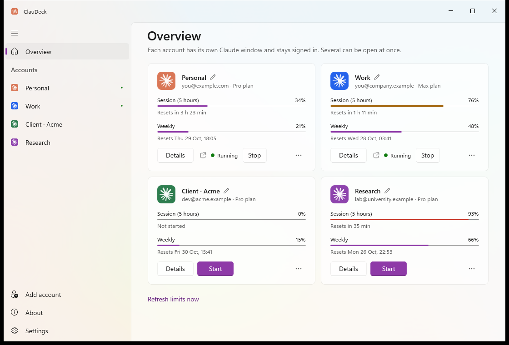
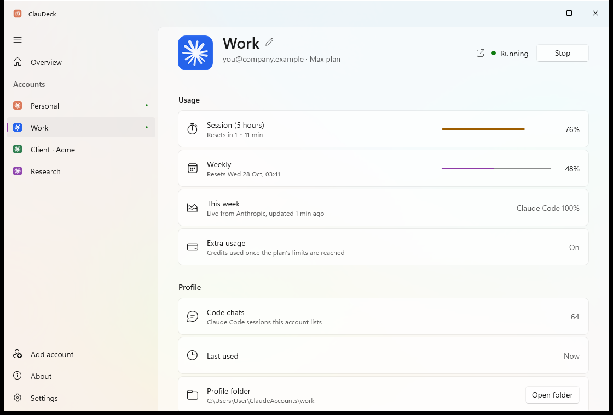
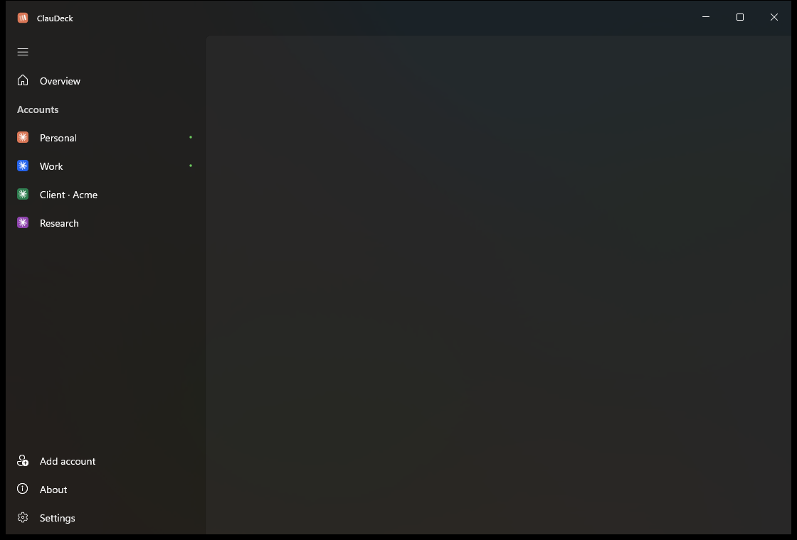

<div align="center">


# ClauDeck for Windows

**Multiple Claude Desktops, in parallel.**<br>
Run every Claude account you have side by side, each signed in for good.

[](https://github.com/ffrafat/claudeck/releases/latest)
[](https://github.com/ffrafat/claudeck/releases)

[](LICENSE)

[**Website**](https://ffrafat.github.io/claudeck/) · [**Download**](https://github.com/ffrafat/claudeck/releases/latest) · [**Report a problem**](https://github.com/ffrafat/claudeck/issues)

<br>

<picture>
  <source media="(prefers-color-scheme: dark)" srcset="docs/assets/screenshots/overview-dark.png">
  
</picture>

</div>

## Why ClauDeck

Claude Desktop holds one account at a time. If you have a personal account and a work
account, or a few for different clients, you sign out of one and into the other, over
and over. On the Mac there are tools for this. On Windows there was nothing that
worked, and the profile tricks people tried broke when Claude moved where it keeps its
data. One wrong click there signs your main account out.

ClauDeck is a native Windows 11 app that does it properly. Every account gets its own
Claude window, its own data and its own sign-in, all running at once. You sign each one
in once, and it stays signed in.

## What it does

- **Every account in parallel.** Start, bring to front or stop each account's Claude
  window from one place. They run side by side, under one Windows user.
- **Signed in for good.** No more signing out to switch. Each account keeps its own login.
- **Live limits for every account.** The 5-hour session and weekly limits, with reset
  times, even for accounts that aren't open. Bars turn amber at 70% and red at 90%.
- **Tell your Claudes apart.** Each account gets a coloured avatar, and its Claude icon in
  the notification area is painted the same colour, with the account's name on hover.
- **Feels like Windows 11.** Mica or Acrylic, light and dark, a Settings-style sidebar,
  and a tray icon that is out of your way.
- **Shortcuts per account.** Pin "Claude - Work" to Start and it opens that account
  directly.
- **Safe by design.** After every launch ClauDeck checks which folder Claude actually
  used, and warns you, rather than letting a Claude update quietly put one account on
  another's data.

<table>
  <tr>
    <td></td>
    <td></td>
  </tr>
</table>

## Download

Go to the [latest release](https://github.com/ffrafat/claudeck/releases/latest) and pick one:

| | |
|---|---|
| **ClauDeck-Setup-*-x64.exe** | The installer. Per user, no administrator prompt, with Start menu and desktop shortcuts and an uninstaller in Settings → Apps. Recommended. |
| **ClauDeck-*-x64-portable.zip** | Unzip anywhere and run `ClauDeck.exe`. |

You need Windows 10 (version 2004 or later) or Windows 11 on x64, and
[Claude Desktop](https://claude.ai/download). Nothing else: ClauDeck carries its own .NET
and WinUI.

> [!NOTE]
> ClauDeck isn't code-signed yet, so Windows SmartScreen may say "Windows protected your
> PC" the first time. Choose **More info → Run anyway**. You can check your download
> against `SHA256SUMS.txt` in the release.

## Using it

1. Open ClauDeck. Your usual Claude account is already there.
2. Choose **Add account**, give it a name, and sign in to the other account in the
   Claude window that opens.
3. From then on: **Start** opens an account's Claude, the small arrow brings it to the
   front, **Stop** closes it. **Details** shows everything about that account.

> [!TIP]
> Sign in inside the new Claude window. If signing in sends you to your web browser and
> back, Windows hands that link to your main Claude. Leave your other Claude windows
> alone until it finishes, then check each account shows the right email in ClauDeck.

## How it works

Each extra account runs the Claude you already have installed, started with its own data
folder (`--user-data-dir`) and its own `LOCALAPPDATA`. That second part is what keeps
recent versions of Claude from relocating the account onto your main account's data. Your
main Claude is never changed: it opens from Start exactly as before.

Limits come from Anthropic's usage service, using the access token each account's Claude
already holds. ClauDeck decrypts it with Windows' own per-user protection, sends it to
`api.anthropic.com` and nowhere else, and never touches the long-term refresh token, so
it can't sign anything out. There's no telemetry, and nothing leaves your PC besides that.

Stopping an account sends Claude the same "please close" signal Windows uses at sign-out,
so Claude shuts down cleanly.

## Building from source

Needs the .NET 10 SDK, and Inno Setup 6 for the installer.

```powershell
.\scripts\build.ps1        # build and install for yourself
.\scripts\release.ps1      # make the installer, portable zip and checksums in artifacts\
.\scripts\screenshots.ps1  # retake the screenshots from demo mode
```

`ClauDeck.exe --demo` runs with sample accounts and changes nothing, for trying it out or
taking pictures.

## Credits

ClauDeck is designed and built by **Faisal F Rafat** ([@ffrafat](https://github.com/ffrafat)).

It stands on the work of others:

- [**claude-graft**](https://github.com/aaditya-v-more/claude-graft) by Aaditya Vitthal
  More (MIT): the macOS app whose approach ClauDeck brings to Windows.
- [**Claude Profile Switcher**](https://github.com/PriyanshuGeTRekT/Claude-Code-Desktop-Switcher)
  by Priyanshu (MIT): the Windows launcher ClauDeck grew out of.
- Windows App SDK, WinUI 3, C#/WinRT and .NET by Microsoft (MIT), and
  [Inno Setup](https://jrsoftware.org/isinfo.php) for the installer.

Full notices are in [THIRD-PARTY-NOTICES.md](THIRD-PARTY-NOTICES.md).

## Licence and disclaimer

[MIT](LICENSE) © 2026 Faisal F Rafat.

ClauDeck is an independent project. It is not made, endorsed or supported by Anthropic.
Claude and the Claude logo are trademarks of Anthropic, PBC. ClauDeck doesn't include
Claude's artwork: account avatars are drawn from the Claude app on your own PC. Using
several Claude accounts is subject to [Anthropic's terms](https://www.anthropic.com/legal/consumer-terms).
